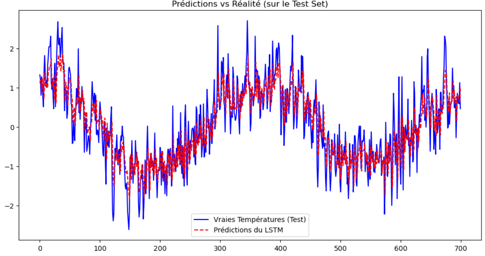

comme ça?
# 🌡️ Prévision de Température par LSTM (PyTorch)

Ce projet implémente un modèle de Deep Learning (LSTM) de bout en bout pour la prévision de séries temporelles. L'objectif est de prédire la température minimale quotidienne à Melbourne, en Australie, à partir d'un historique de 30 jours.

## 🎯 Contexte & Impact
La prévision de séries temporelles est cruciale dans de nombreux domaines (météo, énergie, finance). Ce projet démontre ma capacité à construire un pipeline complet, depuis la préparation rigoureuse des données jusqu'au déploiement du modèle via TorchScript.

## 🛠️ Stack Technique
- **Langage :** Python
- **Deep Learning :** PyTorch (LSTM)
- **Data Manipulation :** Pandas, NumPy, Scikit-Learn
- **Déploiement / Export :** TorchScript (`torch.jit.trace`)
- **Visualisation :** Matplotlib

## 🧠 Méthodologie (Pipeline)
1. **Prétraitement rigoureux :** 
   - Split chronologique (`shuffle=False`) pour éviter toute fuite de données (Data Leakage).
   - Normalisation (StandardScaler) fittée **uniquement** sur le Train Set.
2. **Fenêtrage glissant (Sliding Window) :** Création de séquences 3D de 30 jours (`X`) pour prédire le jour suivant (`y`).
3. **Architecture du modèle :** 
   - 1 couche LSTM (50 neurones cachés).
   - 1 couche Fully-Connected (Linear) pour la sortie.
   - Optimiseur : Adam (lr=0.001).
   - Loss : MSE (Mean Squared Error).
4. **Export :** Sauvegarde du modèle en TorchScript (`.pt`) pour un déploiement futur (ex: API FastAPI).

## 📊 Résultats
Le modèle a été entraîné sur 20 époques. Il parvient à capturer la saisonnalité et la tendance de fond sans sur-apprendre (Train Loss ≈ Val Loss).

 


## 🚀 Comment exécuter le projet

1. Cloner le dépôt :
```bash
git clone https://github.com/JEREMIE-MPEMBELE/prediction-temperature.git


